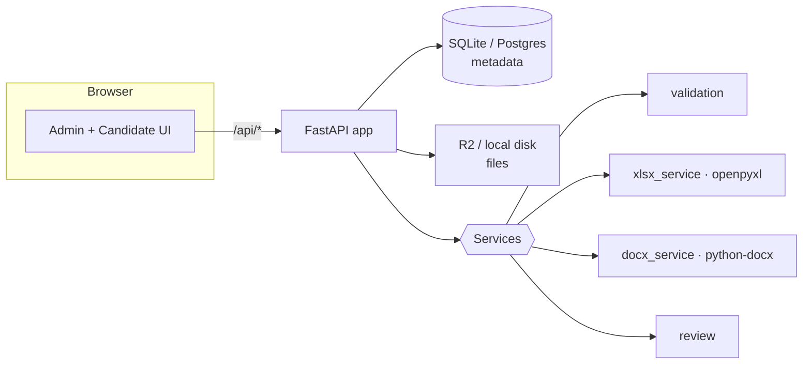

# Assessify — Developer Guide

A deep-dive into how Assessify is built: the architecture, the exact libraries and
API calls used to **edit `.xlsx` and `.docx` files**, how **file downloads** work,
the review pipeline, and how to run and extend the project.

> For setup/run instructions and deployment, see the [README](README.md). This
> guide focuses on *how it works internally*.

---

## 1. What it is (in one paragraph)

Assessify lets an **admin** upload a Word/Excel template, mark which cells
(`Sheet1!B2`) or placeholders (`{{full_name}}`) a candidate must complete, and
share a unique link. A **candidate** opens the link and either edits the file
**in the browser** (a Google-Sheets-style grid or a Google-Docs-style rich editor)
or uploads an edited file. The server writes the answers into the real Office
file, runs **automated review** (required fields, value ranges, type checks,
macro safety, a diff vs. the template), and shows results on a dashboard. All
Office-file parsing happens **server-side** with `python-docx` and `openpyxl`.

---

## 2. Architecture



**Layers (backend, `backend/app/`):**

| Path | Responsibility |
| --- | --- |
| `main.py` | App factory, CORS, global exception handlers, **serves the built UI** |
| `config.py` | Env-driven settings (`pydantic-settings`) incl. `auth_enabled` |
| `database.py` | SQLAlchemy engine/session (SQLite by default) |
| `models/` | `Template`, `CandidateSession`, `Submission` ORM + status enums |
| `schemas/` | Pydantic request/response models, incl. `FieldSpec`, editor payloads |
| `services/storage.py` | R2 (S3 API via boto3) **or** local-disk backend |
| `services/validation.py` | Upload gate: type/size/corruption/**macro** checks |
| `services/xlsx_service.py` | **openpyxl** — read/write cells, grid view, diff |
| `services/docx_service.py` | **python-docx** — placeholders, content controls, HTML↔docx |
| `services/review.py` | Automated checks → `passed`/`failed`/`needs_review` + diff |
| `services/submission_service.py` | Orchestrates store → review → persist |
| `api/` | Routers: `auth`, `admin`, `candidate`, `health` |

**Frontends:** there are two, both talking to the same `/api`:
1. `frontend/` — a **React + TypeScript + Vite + Tailwind** SPA (the "real" UI for deployment).
2. A **single-file, build-free UI** (vanilla JS, no bundler) served directly by
   FastAPI. This was added because the development machine's security tooling
   strips Node executables, so a bundler build can't run there. It uses the exact
   same API. FastAPI serves whichever `FRONTEND_DIST` points at.

---

## 3. Data model & statuses

- **Template** — `id, name, instructions, file_type(docx|xlsx), original_object_key, original_filename, field_spec(JSON), created_at`.
- **CandidateSession** (the link) — `id, template_id, token, candidate_name?, candidate_email?, status, expires_at?, created_at, opened_at?`. Status: `pending → opened → submitted` (+ `expired`).
- **Submission** — `id, session_id, template_id, submitted_object_key, submitted_filename, source(upload|in_browser), field_values(JSON), review_status, review_report(JSON), diff_summary(JSON), score?, created_at, reviewed_at?`. Review status: `pending`, `passed`, `failed`, `needs_review`.

The **field spec** (stored on the template) is what drives both the editor and the
review engine:

```jsonc
// Excel field
{ "id": "score", "label": "Projected score", "sheet": "Sheet1", "cell": "C5",
  "type": "number", "required": true, "min": 0, "max": 100 }

// Word field
{ "id": "cover_letter", "label": "Cover letter", "placeholder": "{{cover_letter}}",
  "type": "string", "required": true, "rich_text": true, "min_length": 100 }
```

---

## 4. Editing Excel (`.xlsx`) — the `openpyxl` API in detail

All Excel logic lives in [backend/app/services/xlsx_service.py](backend/app/services/xlsx_service.py).
The key insight: **an `.xlsx` file is a ZIP of XML**, and `openpyxl` reads/writes
it into a `Workbook` object model.

### 4.1 Loading a workbook

```python
from openpyxl import load_workbook
import io

wb = load_workbook(io.BytesIO(data), data_only=data_only, keep_vba=False)
```

- We load from **bytes** (`io.BytesIO`) because files come from R2/uploads, not disk.
- `keep_vba=False` strips any VBA project — a defense-in-depth step on top of the
  macro rejection in validation.
- `data_only` is important:
  - `data_only=False` → `cell.value` returns the **formula string** (e.g. `"=B2*2"`)
    or the literal value.
  - `data_only=True` → `cell.value` returns the **cached computed value** Excel
    saved last time (openpyxl does **not** evaluate formulas itself).

Because of that, we open the workbook **twice** and pick the right value:

```python
def _effective_value(wb_formula, wb_data, sheet, cell):
    raw = wb_formula[sheet][cell].value          # formula or literal
    if isinstance(raw, str) and raw.startswith("="):
        return wb_data[sheet][cell].value         # cached computed value
    return raw
```

### 4.2 Reading specific cells (extraction)

`extract_field_values()` reads each field's target cell with A1 addressing
(`ws[cell].value`), used both to pull answers from an uploaded file and to build
the diff:

```python
wb_f = _open(data, data_only=False)   # formulas/literals
wb_d = _open(data, data_only=True)    # cached results
values[fd.id] = _effective_value(wb_f, wb_d, fd.sheet, fd.cell)
```

### 4.3 Writing values back (two modes)

Both modes mutate the **original** workbook and re-serialize with `wb.save()`, so
every unrelated cell, style, and sheet is preserved.

**(a) Field-targeted write** — `write_field_values()` (legacy per-field mode):

```python
wb = _open(data, data_only=False)
wb[fd.sheet][fd.cell] = _coerce(fd, values[fd.id])   # assignment writes the cell
out = io.BytesIO(); wb.save(out); return out.getvalue()
```

`_coerce()` converts the submitted string into the declared type (number/integer/
boolean/date), falling back to a string if it doesn't parse (so the review engine
can flag a mismatch rather than crashing).

**(b) Free-grid write** — `write_cells()` (the Google-Sheets-style mode). The
browser sends every edited cell as `{ "Sheet1": { "A1": "Name", "C1": "=B2*2" } }`
and we write them all:

```python
for sheet_name, cells in edits.items():
    ws = wb[sheet_name]
    for addr, value in cells.items():
        ws[addr.upper()] = _coerce_cell(value)
```

`_coerce_cell()` decides literal vs. formula vs. number:

```python
if s.startswith("="):      # openpyxl stores a leading-'=' string AS a formula
    return s
try:    return int(s) or float(s)   # numeric
except: return s                    # text
```

### 4.4 Building the grid the browser renders

`build_workbook_view()` turns the workbook into a JSON grid. It walks the used
range (capped at 200×40 for safety) with `ws.cell(row, column)` and
`openpyxl.utils.get_column_letter` for A1 headers, marking which cells are the
assessed fields:

```python
from openpyxl.utils import get_column_letter
for r in range(1, n_rows + 1):
    for c in range(1, n_cols + 1):
        addr = f"{get_column_letter(c)}{r}"
        raw = ws.cell(row=r, column=c).value
        formula = raw if isinstance(raw, str) and raw.startswith("=") else None
        display = _effective_value(...) if formula else raw
```

Dimensions come from `ws.max_row` / `ws.max_column`; sheet names from
`wb.sheetnames`. Dates are made JSON-safe with `.isoformat()`.

### 4.5 Formula recompute

openpyxl never evaluates formulas. So:
- **On display**, formula cells show the cached value (from the `data_only` load).
- **In the browser**, a tiny, safe evaluator recomputes `SUM/AVERAGE/MIN/MAX/COUNT`
  and `+ - * / ( )` live as you type — purely a UX nicety.
- **Authoritatively**, on submit the server just stores what you typed; range/type
  validation happens in the review engine.

### 4.6 Where pandas fits

`pandas` is listed as a dependency for data manipulation, but the core cell
read/write path deliberately uses **openpyxl directly** for cell-level fidelity
and formatting preservation. pandas is available if you add analytics/tabular
export features later.

---

## 5. Editing Word (`.docx`) — the `python-docx` API in detail

All Word logic lives in [backend/app/services/docx_service.py](backend/app/services/docx_service.py).
A `.docx` is also a ZIP of XML; `python-docx` exposes a high-level object model
(`Document → paragraphs → runs`) and, when needed, the raw OOXML (`oxml`).

### 5.1 Loading + iterating

```python
from docx import Document
doc = Document(io.BytesIO(data))
```

`_iter_paragraphs()` yields **every** paragraph — body, inside tables
(`table.rows → row.cells → cell.paragraphs`), and headers/footers
(`doc.sections → section.header/.footer`) — so placeholders are found anywhere.
`get_full_text()` joins them for the diff/full-text checks.

### 5.2 Two ways answers are captured

Word is trickier than Excel because once a placeholder is edited away, there's no
anchor left. Two mechanisms handle this:

**(a) Named placeholders** like `{{full_name}}` — the write target for the editor
and an "unfilled" sentinel. `find_placeholder_tokens()` regex-scans paragraph text
for `{{...}}`.

**(b) Content controls (Word "structured document tags", `w:sdt`)** — the robust
way to extract answers from an *uploaded* edited document, because the control
survives editing. We drop to OOXML using `docx.oxml.ns.qn` (qualified names) and
iterate:

```python
from docx.oxml.ns import qn
for sdt in doc.element.body.iter(qn("w:sdt")):
    tag = sdt.find(qn("w:sdtPr")).find(qn("w:tag")).get(qn("w:val"))
    texts = sdt.find(qn("w:sdtContent")).iter(qn("w:t"))
    result[tag] = "".join(t.text or "" for t in texts)
```

> Note: SDT elements aren't modeled by python-docx, so they come back as plain
> `lxml` elements. Use `.iter(qn(...))` / `.find(qn(...))` — a **prefixed XPath like
> `.xpath("w:sdtPr")` fails** with "Undefined namespace prefix". (Learned the hard way.)

### 5.3 Writing a value into a placeholder (preserving run formatting)

Word often splits a token like `{{full_name}}` across several *runs*
(`paragraph.runs`, each with its own `run.text` and formatting). To replace it
without wrecking formatting, `_replace_placeholder_in_paragraph()`:

1. Concatenates run texts and finds the token's character span.
2. Maps that span back to the specific runs (`_run_index_at`).
3. Clears the token characters and inserts new run element(s) at the anchor,
   cloning the anchor's run properties (`w:rPr`) so the injected text inherits the
   original font/size.

Rich text (from the editor's TipTap/`contenteditable` HTML) is parsed into
`TextSegment(text, bold, italic, underline)` and turned into raw runs:

```python
from docx.oxml import OxmlElement
from docx.oxml.ns import qn

r = OxmlElement("w:r")
rpr = copy.deepcopy(base_rpr)          # inherit template formatting
if segment.bold:      rpr.append(OxmlElement("w:b"))
if segment.italic:    rpr.append(OxmlElement("w:i"))
if segment.underline: OxmlElement("w:u").set(qn("w:val"), "single")
# text + line breaks
r.append(OxmlElement("w:br"))          # newline
t = OxmlElement("w:t"); t.set(qn("xml:space"), "preserve"); t.text = part
```

Content-control fields are written by setting the inner `w:t` of the matching
`w:sdt` (`_set_content_control`).

### 5.4 Google-Docs-style full-document editing (HTML ↔ docx)

For the full rich-text editor, the whole document is converted to HTML for editing
and rebuilt from HTML on submit.

**`document_to_html()`** walks body paragraphs and maps them to HTML:
- Style name → tag: `Heading 1/Title → <h1>`, `Heading 2 → <h2>`, `Heading 3 → <h3>`, else `<p>`.
- List paragraphs (style contains "List" **or** the paragraph XML has `w:numPr`) → `<li>` inside `<ul>` (detected via `para._p.find(qn("w:pPr")).find(qn("w:numPr"))`).
- Each `run` is wrapped in `<strong>/<em>/<u>` based on `run.bold/italic/underline`, HTML-escaped.

**`html_to_docx()`** rebuilds a clean, macro-free `.docx` from the edited HTML
using an `html.parser.HTMLParser` subclass that drives python-docx's high-level API:

```python
self.para = self.doc.add_paragraph(style="Heading 1")  # for <h1>
self.para = self.doc.add_paragraph(style="List Bullet") # for <li> in <ul>
run = self.para.add_run(text)
run.bold = run.italic = run.underline = True            # from <strong>/<em>/<u>
self.para.add_run().add_break()                          # for <br>
```

> **Tradeoff:** full-document editing regenerates the file from the edited content,
> so it favors the candidate's edits over the template's advanced styling. The
> field-targeted mode (5.3) instead preserves the original file exactly and only
> injects values. Both always produce a valid, **macro-free** document.

### 5.5 Saving

Every write path ends with:

```python
out = io.BytesIO(); doc.save(out); return out.getvalue()
```

---

## 6. Upload validation & macro rejection

Before any file is parsed or stored, [validation.py](backend/app/services/validation.py)
`validate_upload()` enforces (raising a precise error each time):

1. **Size** — empty and over-limit (`MAX_UPLOAD_BYTES`, default 10 MB) rejected.
2. **Real OOXML** — must start with a ZIP signature (`PK\x03\x04` …), not just a
   trusted extension.
3. **No macros** — blocked extensions (`.docm/.xlsm/…`), any embedded
   `vbaProject.bin` zip entry, or macro content-type markers → rejected.
4. **Not corrupt** — `zipfile` central directory readable, expected primary part
   present (`word/document.xml` or `xl/workbook.xml`).
5. **Anti-spoofing** — the declared extension must match the *actual* content
   (a renamed `.xlsm → .docx` is rejected).

The confirmed `FileType` drives `CONTENT_TYPE_BY_FILETYPE`, the OOXML MIME map used
for storage and downloads.

---

## 7. How downloads work

Admins download the **original** template or a candidate's **submitted** file.

### 7.1 Server side

Files are stored as objects (R2 key or local path) and streamed back. In
[admin.py](backend/app/api/admin.py):

```python
from fastapi.responses import StreamingResponse
import io, os, re

def _file_response(data: bytes, filename: str, file_type) -> StreamingResponse:
    media = CONTENT_TYPE_BY_FILETYPE.get(file_type, "application/octet-stream")
    # sanitize to prevent HTTP response header injection
    safe = re.sub(r'[\r\n"]', "", os.path.basename(filename or "download")).strip() or "download"
    headers = {"Content-Disposition": f'attachment; filename="{safe}"'}
    return StreamingResponse(io.BytesIO(data), media_type=media, headers=headers)
```

The bytes come from storage:

```python
data = storage.get(template.original_object_key)      # original
data = storage.get(sub.submitted_object_key)          # submitted
```

Endpoints:
- `GET /api/admin/templates/{id}/original`
- `GET /api/admin/submissions/{id}/file?which=submitted|original`

Both send `Content-Disposition: attachment` with the correct OOXML MIME type so the
browser saves a proper `.docx`/`.xlsx`.

### 7.2 Client side

- **Build-free UI:** downloads are plain links — `<a href="/api/admin/submissions/{id}/file?which=submitted">` / `window.open(...)`. In open mode no token is needed.
- **React UI:** `download()` does an authenticated `fetch`, reads the response as a
  `Blob`, then `triggerBlobDownload()` creates an object URL and clicks a hidden
  `<a download>`:

  ```ts
  const url = URL.createObjectURL(blob);
  const a = document.createElement("a");
  a.href = url; a.download = filename; a.click();
  URL.revokeObjectURL(url);
  ```

---

## 8. Storage backends

[storage.py](backend/app/services/storage.py) defines one interface with two
implementations, chosen by `STORAGE_BACKEND`:

- **`R2Storage`** — Cloudflare R2 via the **S3-compatible API** (`boto3.client("s3", endpoint_url=…)`), using `put_object` / `get_object` / `delete_object` / `head_object`. Errors are converted to clean domain errors (`NotFoundError`, `StorageError`).
- **`LocalStorage`** — disk-backed for dev; keys are validated with `os.path.commonpath` to prevent **path traversal**.

Object keys are UUID-prefixed and basename-sanitized (`make_object_key`).

---

## 9. The review engine

[review.py](backend/app/services/review.py) `review_submission()`:

1. Gets the submitted values — either the **authoritative** values the candidate
   entered in-browser (`provided_values`), or extracted from an uploaded file.
2. Runs per-field checks: required, numeric type, `min`/`max`, `min_length`/
   `max_length`, regex `pattern`, `allowed_values`.
3. For **uploaded Excel**, flags changes to cells outside the assessed set
   ("unexpected changes" → `needs_review`).
4. Builds a **diff** (submitted vs. original template value, per field).
5. Computes status + a simple score (`% of fields that passed`).

Status rule: any error → `failed`; else any warning → `needs_review`; else
`passed`.

---

## 10. Auth (open mode)

`config.auth_enabled` toggles authentication:
- **On** (production default) — admin routes require a JWT; `POST /api/auth/login`
  checks a single admin credential (env-configured, bcrypt-compared) and issues a
  `python-jose` JWT.
- **Off** — `get_current_admin` short-circuits and the console is open (used for
  local/demo). The frontend reads `GET /api/config` (`auth_enabled`) and hides the
  login/sign-out UI accordingly.

Candidate access is always by an **unguessable** `secrets.token_urlsafe` link
token — no candidate login.

---

## 11. API reference (highlights)

| Method & path | Auth | Purpose |
| --- | --- | --- |
| `GET /api/config` | — | `{ app_name, auth_enabled }` for the UI |
| `POST /api/auth/login` | — | Admin login → JWT |
| `POST /api/admin/templates` | admin | Upload + validate a template |
| `PATCH /api/admin/templates/{id}` | admin | Set name / instructions / field spec |
| `GET /api/admin/templates/{id}/original` | admin | **Download** original file |
| `POST /api/admin/sessions` | admin | Create a candidate link |
| `GET /api/admin/submissions` | admin | Review dashboard (filterable) |
| `GET /api/admin/submissions/{id}` | admin | Detail: report + diff |
| `GET /api/admin/submissions/{id}/file?which=` | admin | **Download** submitted/original |
| `POST /api/admin/submissions/{id}/review` | admin | Re-run review |
| `GET /api/candidate/{token}` | link | Open assignment |
| `GET /api/candidate/{token}/workbook` | link | Excel grid for the editor |
| `GET /api/candidate/{token}/document-html` | link | Word doc as HTML (full editor) |
| `GET /api/candidate/{token}/document` | link | Word inline-field blocks |
| `POST /api/candidate/{token}/submit-edits` | link | Submit `cell_edits` / `document_html` / `field_values` |
| `POST /api/candidate/{token}/submit-upload` | link | Submit an uploaded file |

Interactive docs are auto-generated at **`/docs`** (Swagger) and `/redoc`.

---

## 12. Running locally

**Standard (with Node available):**
```powershell
# Backend
cd backend
python -m venv .venv; .\.venv\Scripts\Activate.ps1
pip install -r requirements.txt
copy .env.example .env            # set ADMIN_PASSWORD / JWT_SECRET (or AUTH_ENABLED=false)
uvicorn app.main:app --reload --port 8080
# Frontend
cd ../frontend
npm install
npm run dev                        # http://localhost:5173 (proxies /api to :8080)
```

**Single-process (no Node) — how it's served here:** the backend serves a
pre-built UI folder. Point it with an env var and open one URL:
```powershell
cd backend
$env:FRONTEND_DIST = "C:\path\to\built-ui"     # folder containing index.html
uvicorn app.main:app --host 127.0.0.1 --port 8080
# open http://127.0.0.1:8080  (API + UI same origin)
```
`main.py` mounts `/assets` and falls back to `index.html` for client-side routes.

> **Environment note:** this project was developed on a machine whose security
> tooling deletes downloaded executables (Node, esbuild) and where OneDrive
> dehydrated build outputs — so the Vite build couldn't run there. That's why a
> build-free single-file UI (vanilla JS, same API) exists and is what the backend
> serves. The React app remains the primary UI for normal environments.

---

## 13. Testing

```powershell
cd backend
.\.venv\Scripts\python.exe -m pytest        # 39 tests
```

Covered: macro/spoof/corruption rejection, docx placeholder + content-control +
HTML↔docx round-trips, xlsx read/write/free-grid, the review engine
(pass/fail/needs-review, ranges, diff), and an end-to-end API happy path. Sample
`.docx`/`.xlsx` files are generated in-memory in `tests/conftest.py` (no binary
fixtures committed).

---

## 14. Extending it

- **New field type** — add to `FieldValueType`, handle it in `xlsx_service._coerce`
  and `review._validate_field`.
- **More live formulas** — extend the client evaluator (`SUM/AVERAGE/MIN/MAX/COUNT`
  today); server stays authoritative.
- **Switch to Postgres** — change `DATABASE_URL` (SQLAlchemy abstracts the rest).
- **Enable R2** — set `STORAGE_BACKEND=r2` + the `R2_*` vars; no code change.
- **Richer HTML→DOCX** — extend `_DocxBuilder` (tables, colors, nested lists).

---

## 15. Key files to read first

1. [backend/app/services/xlsx_service.py](backend/app/services/xlsx_service.py) — all openpyxl usage
2. [backend/app/services/docx_service.py](backend/app/services/docx_service.py) — all python-docx usage
3. [backend/app/services/validation.py](backend/app/services/validation.py) — macro/format gate
4. [backend/app/services/review.py](backend/app/services/review.py) — automated checks
5. [backend/app/api/candidate.py](backend/app/api/candidate.py) — the edit/submit flow
6. [backend/app/api/admin.py](backend/app/api/admin.py) — templates, links, dashboard, downloads
