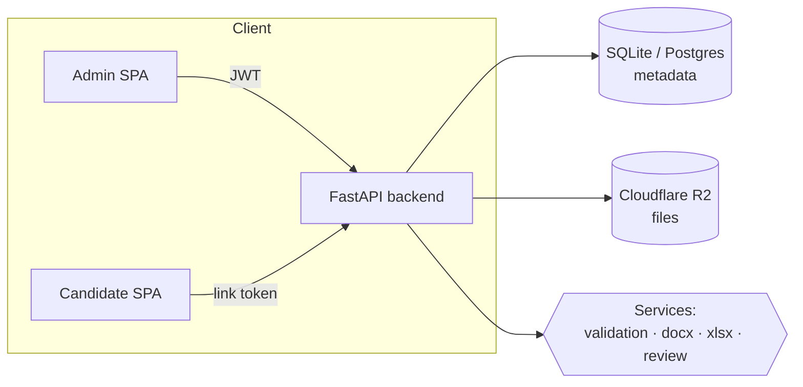

# Assessify — Candidate Assessment Platform

A production-quality web app for running a company's candidate **assessment / take‑home** process.
Admins upload a Word or Excel template, define exactly what candidates must fill in, and share a
unique link per candidate. Candidates complete the task — **in the browser** or by **uploading** an
edited file — and every submission is **automatically reviewed** (required fields, value ranges,
formula/type checks, macro safety, and a diff against the original template).

> Built with FastAPI + python-docx + openpyxl on the backend, React + Tailwind on the frontend,
> Cloudflare R2 for file storage, and deployable to Cloudflare Containers + Pages.

> 📖 **Deep dive:** see the [Developer Guide](DEVELOPER_GUIDE.md) for exactly how the
> `.xlsx`/`.docx` editing, file downloads, and review pipeline work internally.

---

## ✨ Features

**Admin**
- Upload `.docx` / `.xlsx` templates (macro files rejected server‑side).
- Define required fields visually — Excel cells (`Sheet1!B2`) or Word placeholders (`{{full_name}}`),
  with types, ranges, length/pattern rules, and help text.
- Generate unguessable, per‑candidate links (optionally with an expiry).
- Review dashboard with pass / fail / needs‑review status, scores, and filters.
- Per‑submission detail: automated check report, **diff vs. the original template**, downloads of
  both the original and submitted files, and a one‑click **re‑run review**.

**Candidate**
- Clean, mobile‑responsive assignment page with clear instructions.
- **Edit in the browser**:
  - Excel → an interactive spreadsheet grid; only allowed cells are editable and simple formulas
    (`SUM`, `AVERAGE`, `MIN`, `MAX`, arithmetic) recalculate live as you type.
  - Word → inline rich‑text regions rendered over the document text (bold / italic / lists).
- Or **upload** an edited file with drag‑and‑drop and real upload progress.
- Friendly confirmation summarising exactly what was submitted.

**Safety & quality**
- Server‑side validation: correct type, size limit, not corrupt, and **no macros** (`.docm`/`.xlsm`,
  embedded `vbaProject.bin`, and content‑type spoofing are all rejected).
- Every error returns clean, human‑readable JSON — never a raw stack trace.
- Auto‑generated OpenAPI/Swagger docs.
- Modular services (storage, validation, docx, xlsx, review) with an independent unit‑test suite.

---

## 🧱 Tech stack

| Layer            | Choice                                                             |
| ---------------- | ----------------------------------------------------------------- |
| Backend API      | Python 3.11, **FastAPI**, Pydantic v2                             |
| Word handling    | **python-docx**                                                   |
| Excel handling   | **openpyxl** (+ pandas available for data manipulation)          |
| Persistence      | **SQLAlchemy** (SQLite by default; swap the URL for Postgres)     |
| File storage     | **Cloudflare R2** (S3‑compatible via boto3) with a local fallback |
| Auth             | Single admin, JWT sessions (python‑jose), bcrypt hashing          |
| Frontend         | **React + Vite + TypeScript + Tailwind CSS**                     |
| Rich text / grid | **TipTap** editor + a custom accessible spreadsheet grid          |
| Deployment       | **Cloudflare Containers** (backend) + **Cloudflare Pages** (UI)   |

---

## 🗺️ Architecture



The frontend never parses Office files — all parsing, validation, write‑back and review happen
server‑side so the browser can't be tricked into unsafe behaviour, and formatting is preserved by
writing values into the *original* file.

---

## 🧩 Data model

**Template** — an uploaded assessment file and its field spec.
`id · name · instructions · file_type(docx|xlsx) · original_object_key · original_filename · field_spec(JSON) · created_at`

**CandidateSession** — one shareable link per candidate.
`id · template_id · token(unguessable) · candidate_name? · candidate_email? · status · expires_at? · created_at · opened_at?`
- **status:** `pending` → `opened` → `submitted` (plus `expired`).

**Submission** — a submitted file and its review outcome.
`id · session_id · template_id · submitted_object_key · submitted_filename · source(upload|in_browser) · field_values(JSON) · review_status · review_report(JSON) · diff_summary(JSON) · score? · created_at · reviewed_at?`
- **review_status:** `pending` · `passed` (all hard checks) · `failed` (missing required / out‑of‑range / corrupt / macro) · `needs_review` (parses fine but has soft issues for a human).

**Field spec** (stored on the template, drives both the editor and the review engine):

```jsonc
// Excel field
{ "id": "score", "label": "Projected score", "sheet": "Sheet1", "cell": "C5",
  "type": "number", "required": true, "min": 0, "max": 100 }

// Word field
{ "id": "cover_letter", "label": "Cover letter", "placeholder": "{{cover_letter}}",
  "type": "string", "required": true, "rich_text": true, "min_length": 100 }
```

---

## 📁 Project structure

```
Exapdfs/
├─ backend/
│  ├─ app/
│  │  ├─ main.py              # app factory, CORS, global exception handlers
│  │  ├─ config.py            # env-driven settings
│  │  ├─ database.py          # SQLAlchemy engine/session
│  │  ├─ core/                # errors, logging, security (JWT, tokens, hashing)
│  │  ├─ models/              # Template, CandidateSession, Submission
│  │  ├─ schemas/             # Pydantic models incl. FieldSpec
│  │  ├─ services/            # storage · validation · docx · xlsx · review
│  │  └─ api/                 # auth · admin · candidate · health routers
│  ├─ tests/                  # pytest suite (36 tests)
│  ├─ requirements.txt · pyproject.toml
│  ├─ Dockerfile · .dockerignore
│  ├─ worker.ts · wrangler.jsonc · package.json   # Cloudflare Containers glue
│  └─ .env.example
├─ frontend/
│  ├─ src/
│  │  ├─ pages/ (admin/*, candidate/*)
│  │  ├─ components/ (SpreadsheetEditor, DocumentEditor, RichTextEditor, …)
│  │  └─ lib/ (api, auth, types, hooks)
│  ├─ public/_redirects       # SPA fallback for Cloudflare Pages
│  └─ package.json · vite/tailwind/ts config · .env.example
└─ README.md · .gitignore
```

---

## 🚀 Getting started (local)

### Prerequisites
- **Python 3.11+**
- **Node.js 18+** and npm (for the frontend)

### 1) Backend

```powershell
cd backend
python -m venv .venv
.\.venv\Scripts\Activate.ps1        # macOS/Linux: source .venv/bin/activate
pip install -r requirements.txt
copy .env.example .env               # macOS/Linux: cp .env.example .env
# edit .env — at minimum set ADMIN_PASSWORD and JWT_SECRET
uvicorn app.main:app --reload --port 8080
```

- API: http://localhost:8080
- Interactive docs (Swagger): http://localhost:8080/docs
- With the default `.env`, files are stored on local disk under `backend/data/` and metadata in a
  local SQLite file — no cloud account required to try it.

### 2) Frontend

```powershell
cd frontend
npm install
copy .env.example .env               # leave VITE_API_BASE_URL empty for local dev
npm run dev
```

- App: http://localhost:5173 (Vite proxies `/api` to the backend on `:8080`).
- Sign in with the `ADMIN_EMAIL` / `ADMIN_PASSWORD` from `backend/.env`.

### 3) Run the tests

```powershell
cd backend
.\.venv\Scripts\python.exe -m pytest
```

---

## 🔐 Environment variables

### Backend (`backend/.env`)

| Variable                | Default                     | Description                                            |
| ----------------------- | --------------------------- | ------------------------------------------------------ |
| `ENVIRONMENT`           | `development`               | `development` \| `production` \| `test`               |
| `CORS_ORIGINS`          | `http://localhost:5173,...` | Comma‑separated allowed frontend origins               |
| `DATABASE_URL`          | `sqlite:///./data/app.db`   | SQLAlchemy URL (use a Postgres URL to scale)           |
| `ADMIN_EMAIL`           | `admin@example.com`         | The single admin login                                 |
| `ADMIN_PASSWORD`        | `change-me-in-prod`         | **Set a strong value in production**                   |
| `JWT_SECRET`            | `insecure-dev-secret…`      | **Set a long random value in production**              |
| `JWT_EXPIRES_MINUTES`   | `720`                       | Admin session lifetime                                 |
| `MAX_UPLOAD_BYTES`      | `10485760` (10 MB)          | Upload size limit                                      |
| `SESSION_EXPIRY_DAYS`   | `14`                        | Candidate link expiry (`0` = never)                    |
| `STORAGE_BACKEND`       | `local`                     | `local` (disk) or `r2` (Cloudflare R2)                 |
| `LOCAL_STORAGE_DIR`     | `./data/files`              | Directory for the local storage backend                |
| `R2_ENDPOINT_URL`       | —                           | `https://<accountid>.r2.cloudflarestorage.com`         |
| `R2_ACCESS_KEY_ID`      | —                           | R2 access key                                          |
| `R2_SECRET_ACCESS_KEY`  | —                           | R2 secret key                                          |
| `R2_BUCKET`             | `assessments`               | R2 bucket name                                         |

### Frontend (`frontend/.env`)

| Variable              | Description                                                             |
| --------------------- | ----------------------------------------------------------------------- |
| `VITE_API_BASE_URL`   | Backend base URL in production (empty for local — Vite proxies `/api`). |
| `VITE_DEV_API_TARGET` | Dev‑only proxy target (default `http://localhost:8080`).                |

---

## 📡 API overview

Full interactive documentation is generated automatically at **`/docs`**. Highlights:

| Method & path                                   | Auth   | Purpose                                   |
| ----------------------------------------------- | ------ | ----------------------------------------- |
| `POST /api/auth/login`                          | —      | Admin login → JWT                         |
| `POST /api/admin/templates`                     | admin  | Upload a template (validated)             |
| `PATCH /api/admin/templates/{id}`               | admin  | Set name / instructions / field spec      |
| `POST /api/admin/sessions`                      | admin  | Create a candidate link                   |
| `GET  /api/admin/submissions`                   | admin  | Review dashboard (filterable)             |
| `GET  /api/admin/submissions/{id}`              | admin  | Submission detail + report + diff         |
| `GET  /api/candidate/{token}`                   | link   | Open the assignment                       |
| `GET  /api/candidate/{token}/workbook`          | link   | Spreadsheet grid for the editor           |
| `GET  /api/candidate/{token}/document`          | link   | Word document blocks for the editor       |
| `POST /api/candidate/{token}/submit-edits`      | link   | Submit in‑browser edits                   |
| `POST /api/candidate/{token}/submit-upload`     | link   | Submit an uploaded file                   |

---

## 🛡️ Security notes

- **No macros, ever.** Uploads are rejected if they use a macro‑enabled extension
  (`.docm`/`.xlsm`/…), contain an embedded `vbaProject.bin`, or declare a macro content type.
- **Anti‑spoofing.** The declared extension must match the file's actual OOXML content
  (a renamed `.xlsm → .docx` is rejected).
- **Bounded input.** Size limits, empty‑file and corrupt‑zip detection, and capped grid dimensions.
- **Least exposure.** Candidate access is by an unguessable `secrets.token_urlsafe` token; admin
  routes require a JWT. Errors are returned as sanitised JSON with no internal details.
- **Path‑traversal safe** local storage keys; R2 keys are UUID‑prefixed.

---

## 🧠 In‑browser editing — how it works (and tradeoffs)

The server always writes candidate values into the **original** file (via python-docx / openpyxl),
so template formatting is preserved and the output is guaranteed macro‑free.

- **Excel:** the grid sends values for the allowed cells; the server writes them into those cells.
  Client‑side formula recalculation is a convenience for common functions — the **authoritative**
  recompute and range validation run server‑side on submit.
- **Word:** answers are captured from the in‑browser fields (authoritative) and injected at their
  placeholders. A safe subset of rich text (bold / italic / underline / line breaks) is mapped to
  Word runs; full HTML→DOCX styling (nested lists, colours, tables) is an intentional non‑goal so
  the resulting document is always valid. The candidate's full rich text is preserved on the
  submission record and shown in the review UI.
- **Uploaded Word files:** per‑field answers are extracted from **content controls** (tagged with
  the field id) when present; otherwise the reviewer is prompted to check the field manually.

> A **full WYSIWYG** editor that round‑trips arbitrary DOCX/XLSX formatting was deliberately avoided —
> it is brittle and error‑prone. The approach above delivers a genuinely "rich" editing feel while
> keeping submissions safe and faithful to the template.

---

## ☁️ Deployment (Cloudflare)

### 0) Create an R2 bucket
1. In the Cloudflare dashboard: **R2 → Create bucket** (e.g. `assessments`).
2. Create an **R2 API token** (Access Key ID + Secret) and note your account's
   `https://<accountid>.r2.cloudflarestorage.com` endpoint.

### 1) Backend → Cloudflare Containers
The backend ships with a `Dockerfile`, a small Worker (`worker.ts`) and `wrangler.jsonc` that runs the
container behind a Durable Object.

```powershell
cd backend
npm install                     # installs wrangler + @cloudflare/containers
# Set secrets (never commit these):
npx wrangler secret put ADMIN_PASSWORD
npx wrangler secret put JWT_SECRET
npx wrangler secret put R2_ENDPOINT_URL
npx wrangler secret put R2_ACCESS_KEY_ID
npx wrangler secret put R2_SECRET_ACCESS_KEY
# Non-secret vars (ENVIRONMENT, STORAGE_BACKEND=r2, CORS_ORIGINS, …) live in wrangler.jsonc.
npx wrangler deploy
```

> **State note:** SQLite in a container is ephemeral. For anything beyond a demo, point
> `DATABASE_URL` at a managed Postgres (e.g. Neon/Supabase) — it's a one‑line change thanks to
> SQLAlchemy. Files already persist in R2.

### 2) Frontend → Cloudflare Pages
1. **Pages → Create project → Connect to Git** (or `npx wrangler pages deploy dist`).
2. Build settings: **build command** `npm run build`, **output directory** `dist`.
3. Environment variable: `VITE_API_BASE_URL = https://<your-backend-worker-url>`.
4. `public/_redirects` is included so client‑side routes (e.g. `/c/<token>`) resolve correctly.

Finally, set the backend `CORS_ORIGINS` to your Pages URL so candidate links and API calls line up.

---

## 🔭 Possible next steps
- Managed Postgres + Alembic migrations.
- Multi‑admin accounts and roles.
- Email delivery of candidate links.
- Background review queue for very large files.
- More Excel functions in the live client‑side recompute.

---

## 📝 License
Provided as a portfolio/demo project. Adapt freely for your own use.
